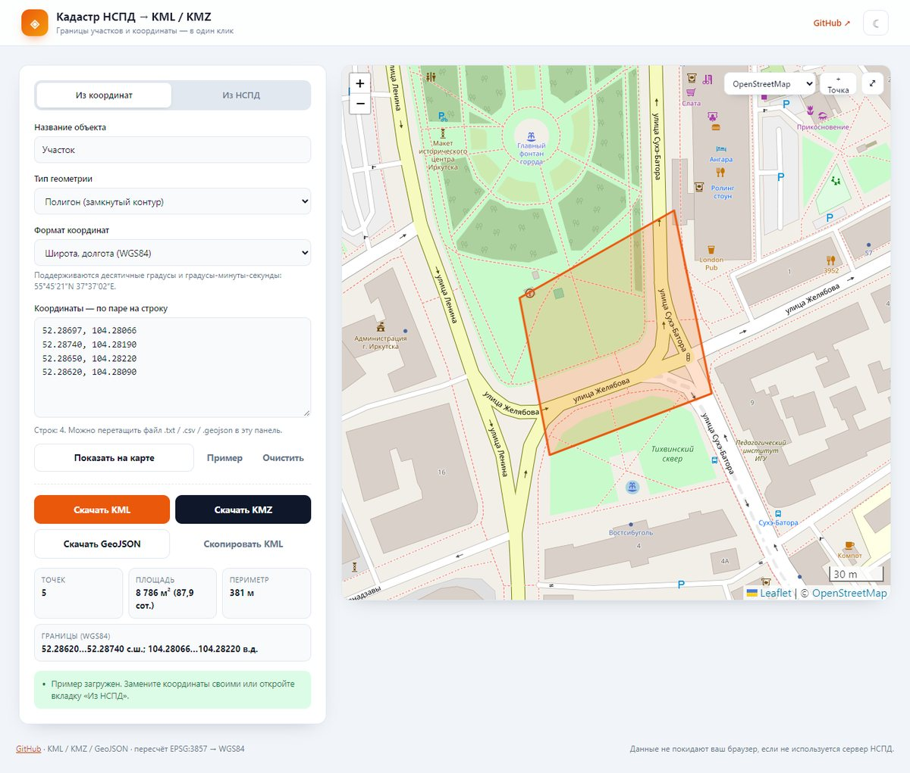

# Кадастр НСПД и координаты → KML / KMZ

[](https://github.com/DmitryLeLeE/cadastr-to-kml/actions/workflows/ci.yml)

Конвертер координат и границ объектов из публичного API НСПД в **KML**, **KMZ** и **GeoJSON**.
Автоматически пересчитывает EPSG:3857 → WGS84, проверяет геометрию и считает площадь с периметром.



🌐 **Онлайн-версия (без установки):** <https://dmitrylelee.github.io/cadastr-to-kml/>

## Возможности

**Веб-интерфейс (`docs/`)**
- Ввод координат: `lat, lon`, `lon, lat`, метры EPSG:3857, автоопределение, градусы-минуты-секунды.
- Полигон, линия или набор точек; добавление точек кликом по карте.
- Разбор ответа НСПД/GeoJSON из буфера обмена или файла, drag & drop.
- Предпросмотр на карте (OSM, спутник, топо), площадь, периметр, границы.
- Экспорт KML, KMZ, GeoJSON и копирование KML в буфер обмена.
- Светлая/тёмная тема, адаптивная вёрстка, всё считается локально в браузере.

**CLI (`cadastr_to_kml.py`)**
- Выгрузка по кадастровому номеру в KML/KMZ/GeoJSON.
- Конвертация файла координат, сохранение исходного JSON НСПД.
- Коды возврата и понятные ошибки для скриптов и пакетной обработки.

**Сервер (`web_app.py`, FastAPI)**
- REST API: поиск в НСПД, экспорт, конвертация произвольного GeoJSON.
- Кэш и повторные попытки запросов к НСПД, корректные HTTP-коды ошибок.
- Раздача веб-интерфейса и health-check; готовый Docker-образ.

## Быстрый старт

### Онлайн

Откройте <https://dmitrylelee.github.io/cadastr-to-kml/> — ничего устанавливать не нужно.
JSON из НСПД вставляется вручную, потому что браузер не может обращаться к `nspd.gov.ru` напрямую из-за CORS.

### Локально

```bash
git clone https://github.com/DmitryLeLeE/cadastr-to-kml.git
cd cadastr-to-kml
python -m venv .venv
# Windows: .venv\Scripts\activate
# Linux/macOS: source .venv/bin/activate
pip install -r requirements.txt
```

Запуск сервера с веб-интерфейсом:

```bash
uvicorn web_app:app --reload --port 8000
```

Откройте <http://127.0.0.1:8000/>. При запущенном сервере в интерфейсе появляется
кнопка «Загрузить из НСПД (через сервер)» — запрос выполняется с бэкенда, без ограничений CORS.

## CLI

```bash
# KML по кадастровому номеру (файл создастся рядом)
python cadastr_to_kml.py 38:06:144003:4723

# KMZ с явным именем файла
python cadastr_to_kml.py 38:06:144003:4723 --format kmz -o uchastok.kmz

# Из файла координат: по паре на строку
python cadastr_to_kml.py --coords coords.txt --type polygon --name "Участок"

# Сохранить исходный ответ НСПД и слой ЗОУИТ
python cadastr_to_kml.py 38:06:144003:4723 --thematic-id 5 --json raw.json
```

Без аргументов скрипт спросит кадастровый номер. Справка: `python cadastr_to_kml.py --help`.

Пример `coords.txt`:

```
# широта, долгота
52.28697, 104.28066
52.28740, 104.28190
52.28650, 104.28220
```

Порядок координат задаётся `--order latlon|lonlat|auto`, система координат — `--crs auto|wgs84|epsg3857`.

## REST API

| Метод | Путь | Назначение |
| --- | --- | --- |
| `GET` | `/api/health` | статус и версия |
| `GET` | `/api/layers` | доступные слои НСПД |
| `GET` | `/api/nspd?cadnum=…&thematic_id=1` | данные объекта в WGS84 (без сырого ответа) |
| `GET` | `/api/export?cadnum=…&fmt=kml\|kmz\|geojson` | файл по кадастровому номеру |
| `POST` | `/api/convert` | конвертация GeoJSON в KML/KMZ/GeoJSON |

```bash
curl -o parcel.kml "http://127.0.0.1:8000/api/export?cadnum=38:06:144003:4723"

curl -X POST http://127.0.0.1:8000/api/convert \
  -H "Content-Type: application/json" \
  -d '{"geojson":{"type":"Point","coordinates":[104.28,52.28]},"name":"Точка","format":"kmz"}' \
  -o point.kmz
```

Интерактивная документация: <http://127.0.0.1:8000/docs>.

Тело `/api/convert`:

```json
{
  "geojson": {"type": "Polygon", "coordinates": [[[4187000, 7476000], "…"]]},
  "name": "Участок",
  "format": "kml",
  "crs": "epsg3857"
}
```

`crs`: `auto` (по умолчанию), `wgs84`, `epsg3857`. Поддерживаются все основные типы GeoJSON,
включая `MultiPolygon` и `GeometryCollection`.

## Форматы и системы координат

- Вход: десятичные градусы (`55.7558, 37.6173`), `lon, lat`, метры EPSG:3857, DMS
  (`55°45′21″N 37°37′02″E`) в веб-интерфейсе.
- Выход: KML 2.2 и KMZ (WGS84), GeoJSON (WGS84).
- Площадь и периметр считаются по сферической модели; для бытовых задач точность достаточная,
  для кадастровых измерений используйте специализированное ПО.

## Настройки

| Переменная | По умолчанию | Описание |
| --- | --- | --- |
| `NSPD_INSECURE_TLS` | выкл. | `1` отключает проверку TLS-сертификата НСПД сразу (иначе клиент один раз пробует проверку и при ошибке цепочки повторяет запрос без неё) |

В CLI то же самое делает флаг `--insecure`. Проверка сертификата включена по умолчанию; сертификат НСПД
выпущен российским УЦ и может отсутствовать в `certifi`, поэтому предусмотрен автоматический повтор.

## Разработка

```bash
pip install -r requirements-dev.txt
python -m pytest          # тесты ядра и API
ruff check .              # линтер
node --check docs/app.js  # синтаксис фронтенда
```

Структура проекта:

```
core.py               # конвертация, метрики, клиент НСПД
web_app.py            # FastAPI: API + раздача docs/
cadastr_to_kml.py     # CLI
docs/                 # статический веб-интерфейс для GitHub Pages
  index.html
  app.js
  styles.css
  theme.js
tests/                # pytest: core + API
.github/workflows/    # CI (Python 3.10–3.12, ruff, pytest, node --check)
Dockerfile
```

Docker:

```bash
docker build -t cadastr-to-kml .
docker run --rm -p 8000:8000 cadastr-to-kml
```

## Ограничения

- Публичный API НСПД не имеет стабильного контракта: при изменениях формата ответа
  парсер может потребовать обновления.
- Массовая автоматическая нагрузка на НСПД не приветствуется — используйте кэш и разумные паузы.
- Проект не связан с Росреестром/НСПД; данные предоставляются «как есть».
